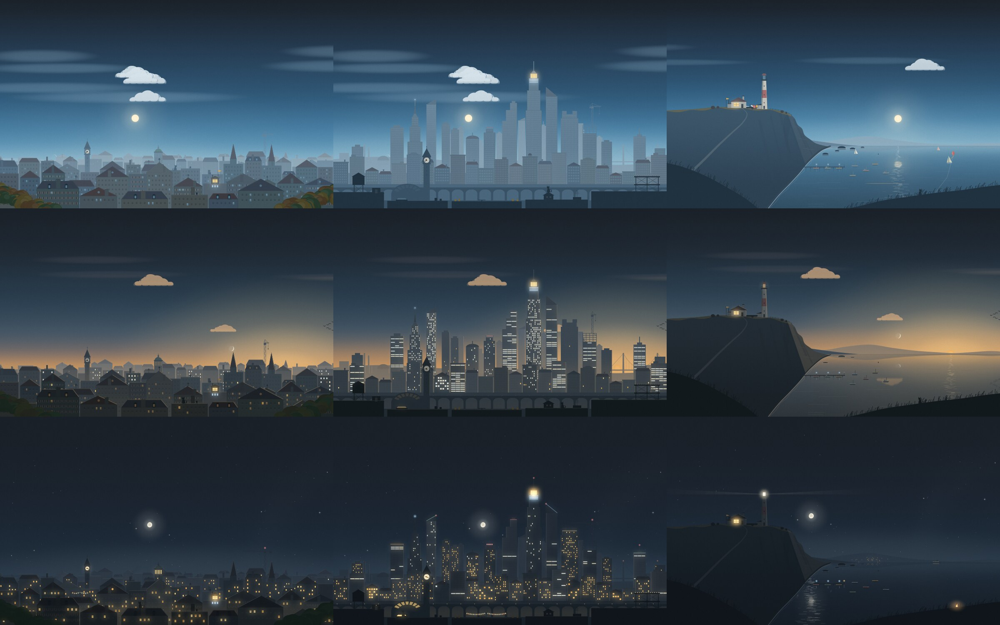
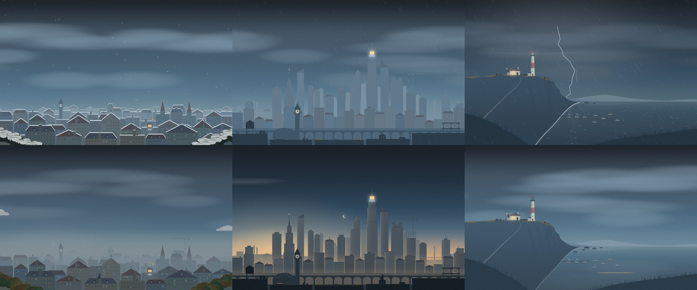

# dormer

A dormer is the window that sits in a roof. This one is your wallpaper: the
same view every day, under the sky that is actually over you right now.

dormer is one small native program. It paints a place from things that are true
at this moment, and keeps it alive on your desktop: the sun and moon where they
really are, tonight's real stars and planets, the weather outside, the rhythm
of the week, and a few signals from your own machine.



## Six views

Four of them are places under your own sky, one is a valley in another world
under that same sky, and one is on the moon, where the sky is the earth's to
fill:

| | |
| --- | --- |
| `rooftops` | The old town from a window in the roof: painted walls, tiled roofs, a clock tower, a domed hall. |
| `street` | A block of walk-ups across a narrow street, from your own windowsill: fire escapes and water tanks, a diner, a bodega, cabs, people going by. The view for being indoors. |
| `city` | The middle of town across a railway viaduct: towers placed by hand, offices that keep office hours, trains to a timetable. |
| `coast` | A headland and its lighthouse over the strait: the sea mirrors the sky, and the tide follows the moon. |
| `moon` | A station on the Lake of Dreams. The earth hangs overhead with its true face and phase; the sun is up for a fortnight and down for a fortnight. |
| `vale` | A valley of hanging rocks, a wizard's tower and a great tree, with a second, ringed moon that keeps the week. |

```sh
dormer view            # list them
dormer view street     # look out there from now on; the wallpaper fades over
dormer view default    # back to what the config says
```

Your machine shows in the same four ways everywhere, staged for the place:

| | rooftops | street | city | coast | moon | vale |
| --- | --- | --- | --- | --- | --- | --- |
| An AI coding agent is running | the lamp in the roof room | the neighbour across the way at their desk, working by the lamp | the lantern on the tallest tower | the lamp in the keeper's window | the lamp in the cupola | the lamp in the tower's top room |
| Each running Docker container | a blue window under it | a blue jar lit on their fire escape | a blue floor under it | a blue lantern on a moored boat | a cargo pod lit blue | a rune lit blue on a standing stone |
| The processor is working hard | smoke from its stovepipe | steam from a manhole in the road | steam off the tower's roof | smoke from the lean-to's stovepipe | the vent blowing, the radiators glowing | violet smoke from the flue |
| Sound is playing | notes drift from it | the neighbour picks up the guitar; notes drift from their window | notes drift from it | notes drift from it | notes drift from it |

The lamp burns low and red when the battery is nearly flat.

## Touching the view

Move the mouse over the exposed wallpaper and click what is there. The clock
and windows catch a little light; birds leave their perch. On the coast the
water ripples, on the moon a little dust lifts from the ground, and in the vale
the tree and stones release small lights. In the street, the cat on your sill
turns an ear and the wet road answers with ripples. Reactions fade back into
the ordinary scene; they do not change the real time, weather or machine signals.

The wallpaper takes mouse input only where it is exposed. Application windows
keep their input, and dormer never takes keyboard focus. If your desktop has
icons beneath the wallpaper, set `interactive = false` under `[live]` to pass
clicks through to them. Restart `dormer live` after changing that setting.

Reactions stay on the monitor you touched. They have fixed limits and short
lifetimes; moving the mouse does not rebuild the still picture. A stationary
hover settles, and hidden, sleeping or held wallpapers accept no new reactions.

To try a reaction without changing your desktop, use a headless export:

```sh
dormer live --frame ripple.png --view coast --at '2026-10-13 21:00' \
  --weather clear --mode dark --seconds 0.7 --pointer 1170,790 --click 1170,790
```

Coordinates use the 1600x1000 design space. `--seconds` sets how far the
simulation runs after the click. PNG exports still read your config and weather
sources; see `AGENTS.md` for an isolated, offline preview setup.

## Settings panel

`dormer dev` opens a panel over the wallpaper where you choose a view, adjust
it while you watch the scene, and save what should stay.

A header says where you stand, in words: **Saved**, **Unsaved changes (3)**,
**Preview only**, **Saving…**, or **Not saved** with the reason. Views are
across the top; the sections are *Appearance*, *Sky & weather*, *Machine
preview*, *Activity* and, for views that have them, *This view*. Click a name,
or press `1`–`5`.

Every input of the sky and the house is either **auto** (it follows the real
time, weather and machine) or **fixed** (held at the value you chose). Moving a
control fixes it; `a` or the `[fixed]` tag gives it back. Machine values you fix
are simulations (a pretend agent session, pretend load), and the save summary
names them.

| Keys | |
| --- | --- |
| `↑ ↓` `Tab` `Shift-Tab` | choose a control |
| `← →` `h l` | adjust (`Shift`, `[` `]` or Page Up/Down: larger steps) |
| `Enter` | type a value (`21:30`, `2026-10-15`, `40%`, `auto`); `Esc` cancels |
| `Space` | switch on/off, or fix / give back to auto |
| `a` `n` `r` `d` | auto · time and date to now · reset to saved · discard all |
| `s` or `Ctrl-S` | save to `config.toml` |
| `p` `?` `q` | pin the preview · help · quit (asks if unsaved) |

With the mouse, click or drag a slider (letting go anywhere ends the drag), use
the wheel to scroll the list, and click `[Save]`, `[Discard]`, `[Reset]`,
`[Preview]`, `[Help]` or `[Quit]` (a button fires when you release on it).

While you hold a slider the dedicated panel fades and shows only that control,
in the same place, leaving the scene in view; it never resizes or moves.
On Hyprland the dedicated panel floats and fades; `dev --here` uses the current
terminal's own opacity settings.

### What Save does

Save writes your edits into `config.toml`, keeping its comments, key order,
unknown keys and permissions, through a temporary file in the same directory
and a `config.toml.bak` of what was there. It refuses to overwrite a file that
changed since the panel opened it: you can reload (your edits stay on top of
the new file) or overwrite on purpose. If the write fails, nothing is changed
and your edits stay in the panel. A view you chose earlier with `dormer view`
outranks `[look] view`; saving a view clears that choice so the saved one wins.

A running `dormer live` notices the saved file and follows it without a
restart (frame rate, mouse reactions, view, fixed inputs). Closing the panel
removes only the transient preview: what you saved stays in force.

Order of precedence, lowest first: the real world, your saved `config.toml`
(`[scene]`, `[activity]`, `[views.NAME]`), the panel's unsaved draft, then
explicit command-line flags such as `--weather` or `--at`.

## What the sky is telling you

This is the sky of `rooftops`, `street`, `city`, `coast` and `vale`. The moon has none of
it: see its own rows further down.

| You see | It means |
| --- | --- |
| The sun, the colour of the sky | The real sun over your latitude. It rises on the left and sets on the right. |
| The moon | Its real position and phase, with the bright limb turned towards the sun. |
| Stars, a few with a sparkle | The real brightest stars (Orion in winter, the Summer Triangle in summer), turning through the night. Steady bright points are Venus, Mars, Jupiter and Saturn. On dark moonless nights the Milky Way shows where it really lies. |
| More shooting stars than usual | A real meteor shower is at its peak. |
| Cloud, rain, snow, fog, lightning | The current weather. Clouds drift with the wind that is blowing. |
| A dark bank of cloud on one side | Rain is forecast within the next few hours; it builds on the side the wind comes from. |
| Mist lying low, frost on the roofs | Still, damp air near sunrise; a freezing night. |
| Windows lit or dark | Every window keeps its own hours. Homes wake, empty out and go to bed; offices light up on working days only. |
| How many planes cross, the crane turning | A working day. Monday starts earliest and is busiest. |
| `z z z`, washing on a line, a balloon, a kite | The weekend. |
| The cat | Somewhere different every hour and a half, asleep at night, indoors when it rains. |

And in each view, a few things of its own:

| | You see | It means |
| --- | --- | --- |
| rooftops | The clock tower | The real time. On the hour the birds on it take off. |
| | String lights on a roof | Friday and Saturday night, and every night in late December. Fireworks at New Year. |
| street | The glass | You are indoors: the rain falls beyond your sill, beads soft and out of focus on the pane and runs down it, and on a cold or wet day the bottom of the glass mists over. |
| | The sun | It comes up behind the low diner on the left, and goes down at the far end of the cross street, every day. For the last hour its light runs gold down that street, across yours and in at your window, where what stands on the sill throws long shadows. |
| | The neighbour | At the desk while an agent works, playing the guitar while sound plays. Otherwise their own day: coffee at the window, out at work, reading, a film in the evening, asleep. |
| | The shops | Their hours: the diner six till one, the laundromat seven till eleven, the bookshop ten till nine (a lamp left on in the window after), pizza till three, the bar from five, the bodega always. |
| | Cabs, cars, the bus, a courier | As busy as the hour and the day: the rush, a quiet Sunday, a lone cab at four. The bus every ten minutes on a working day, none between half past one and five. |
| | People walking by | The same: dogs walked morning and evening, a runner at dawn, umbrellas when it rains, someone ducking into the bodega. |
| | The road shining, puddles | Rain now; puddles linger when the air is damp. The lights lie in the wet road. |
| | The traffic light | It changes every minute or so; the hand blinks before the little man comes on. |
| | The cat | Along the roofs and fire escapes when it is dry, on your sill watching when it rains, asleep there at night. |
| city | The station clock | The real time. |
| | A train on the viaduct | The timetable: every three minutes at the rush on a working day, every nine at the weekend, none between half past midnight and five. |
| | The light on the old exchange's mast | A weather beacon. Steady blue: fair ahead. Flashing blue: cloud about. Red: rain now or on the way. |
| | Lines of light along the rooflines | After dark, until one in the morning. |
| coast | Rocks and a sandbar showing | Low water. The tide is worked out from where the moon is: about right for an open coast, not a tide table. |
| | A path of light on the water | The low sun, or a bright moon. |
| | A ferry on the horizon | It left on the hour, and takes twelve minutes to cross. |
| | Small boats with lamps; sails | Fishing before sunrise on a working day; sails out at the weekend when there is wind. |
| | A fire on the dune | Friday and Saturday night. |
| moon | The earth | Its real phase (the opposite of the moon's as you see it) and the side really turned towards the moon just now. The coasts are drawn by hand. Cloud over home is as thick as the weather reading says; the rest of the cloud is invented. A ring marks home when it is in sight. The disc is drawn larger than life. |
| | The sun, the length of the shadows | The lunar day. The station has its noon just before full moon and its midnight just before new; shadows are long for days at each end. Its sky is black at noon and the stars never twinkle. |
| | A red ring round a dark earth | The sun has gone behind it: a lunar eclipse at home. |
| | Round windows lit, the garden glowing pink | Daytime at home: the crew keep your hours. One blue window means they are asleep. The tree in the garden keeps your season. |
| | The lander | It comes down on the hour and leaves at half past. |
| | The rover and two figures out on the plain | Working hours on a working day. |
| | Someone sitting on the rock in front | Off duty: evenings in the week, most of the weekend. |
| vale | The small ringed moon | The week. It rises on the left on Monday morning and sets on the right on Sunday night. |
| | The waterfall | The weather: in spate when it rains, a trickle in a dry heat, a column of ice in a hard frost. |
| | The great tree | The season: blossom, leaf, colour, bare branches. Three of its lanterns are lit on any night, all of them on Friday and Saturday. |
| | Snow on the peaks | It comes further down the colder it is. |
| | A ship in the air | It set off on the hour, and takes nine minutes to cross. |
| | Lights in the hamlet and the tower | Village hours. On the hour the birds on the tower take off. |

`dormer explain` says the same in words.



## Install

Rust, and a Wayland compositor with layer-shell (developed on Hyprland).

```sh
git clone <this repository> && cd dormer
cargo build --release
install -Dm755 target/release/dormer ~/.local/bin/dormer

dormer doctor      # what dormer found: place, weather source, wallpaper daemon
dormer install     # the living wallpaper on login, and a still copy every five minutes
```

`dormer install` writes three systemd user units. `dormer live` is the living
wallpaper; `dormer draw` (on a timer) hands a still frame to your wallpaper
daemon, which is what a lock screen shows and what remains if `dormer live` is
not running. `dormer install --no-live` keeps only the still frames.

## Commands

`dormer --help` lists everything. The ones you will use:

| | |
| --- | --- |
| `dormer view street` | Look out somewhere else: `dormer view` lists them. |
| `dormer explain` | Describe the scene in words. Takes `--at`, `--weather` and `--view`. |
| `dormer tour` | Play today from midnight to midnight, smoothly, in about a minute. |
| `dormer pretend snow` | Borrow some weather for ten minutes. |
| `dormer draw --out a.png --at "2026-12-31 23:50"` | Draw another moment to a file. |
| `dormer sheet out.png "2026-10-13 07:10,city" "2026-10-13 21:00,storm,coast"` | Several moments on one sheet. |
| `dormer hold on` / `off` | Freeze or release the living wallpaper (for a lock screen's hooks). |
| `dormer dev` | The settings panel: choose the view, adjust every input and the view's own knobs while the wallpaper follows, and save what should stay. |
| `dormer doctor` | Show what is in effect on this machine. |

## What it costs

Measured on a 1920x1200 laptop screen (Core Ultra 5):

| | |
| --- | --- |
| Painting one still frame, any view | 15 to 17 ms (about 21 ms with the final pass), once every twenty seconds |
| Living wallpaper, a calm scene in view | 0.6 to 1.5% of one core |
| The `street` view in view, with its traffic always about | about 3% of one core |
| Rain or snow in view | about 7% of one core: the whole screen changes every frame |
| Wallpaper covered by a tiled or fullscreen window, or by floating ones that fill the screen | nothing |
| Screen off or asleep, but not locked | nothing |
| Memory | about 35 MB |

Only the rectangles the moving things touch are repainted and reported to the
compositor. Under Hyprland it stops the moment a window covers the workspace.
On any compositor it stops when the screen stops showing frames, and it does not
keep a hidden picture up to date: it paints the present moment as it comes back.

## Configuration

Everything is optional; see [`config.example.toml`](config.example.toml).
With the Noctalia shell running, dormer reads its location and cached weather
and makes no network requests. Without it, set `[place]` and dormer asks
[Open-Meteo](https://open-meteo.com) at most every twenty minutes (through
`curl`; your coordinates are sent to that service).

The `swww`, `hyprpaper` and `command` backends for the still frame are
implemented from their documentation and have not been tested.

## How it works

- `sky.rs` computes the sun, moon and planets with low-precision formulas and
  holds a small catalogue of the brightest stars.
- `scene.rs` turns a time, the weather and the machine into colours and facts.
- `gfx.rs` is dormer's own renderer: exact-area antialiasing, floating-point
  compositing, bloom, and a fixed grain that hides banding.
- `paint.rs` paints the sky, then hands over to the view for the ground.
- `views/` holds the views. Each says where its horizon is, lays its ground
  out once for a screen size, paints it, and draws the few things of its own
  that move. `views/kit.rs` turns a hand-written table of buildings into a
  skyline with windows that keep hours.
- `live.rs` simulates what is in the air, and animates whatever a view points
  at while painting: a chimney here, a television behind that window, a
  beacon there. `wl.rs` puts it on a layer surface.
- `settings/` is the saved configuration as a typed snapshot (fixed or auto
  inputs, activity rates, per-view knobs) and its comment-preserving writer;
  `dev.rs` and `dev/` are the panel. `dormer soak` draws thousands of random moments in
  every view to shake out faults; `cargo test` checks the sky and the hours
  people keep.

### Adding a view

Write a module in `src/views/` with a type that implements `View` (its name,
its horizon, its knobs for the dev panel, its words for `dormer explain`) and
a `Stage` (lay out, paint the ground, draw what moves), and add it to `ALL` in
`views/mod.rs`. The command line, the config, the dev panel and the soak test
pick it up from there. `coast.rs` is the one to read for land drawn by hand;
`downtown.rs` for buildings.

A view under our own sky gets the sun, moon, stars, clouds and weather painted
for it, and may add something of its own behind the clouds in `heavens` (the
little moon in `vale.rs`). A view that returns `Sky::Void` from `sky` gets
nothing overhead and no weather, birds or planes: it paints the whole sky
itself (`moonbase.rs`), with the painter's star field and Milky Way there to
call. Whatever a view paints in `indoors` is nearer than the weather: the
rain falls behind it (the sill in `street.rs`). `Layout::scaled` and
`Layout::moved` resize or slide one part of a view without rewriting its
numbers. `dormer globe --out map.png` writes the earth's
coastlines out flat, for checking them.

Setting `DORMER_TIME` prints how long each stage of a still frame took;
`DORMER_PROBE` makes `dormer live` report where its time goes every five
seconds.

## Ideas not built yet

Rain on its own half-resolution surface (to cut its cost), car lights in the
streets, trees swaying, an owl and bats at dusk, the ISS on its real passes,
puddle sheen on wet roofs, crepuscular rays, configurable holidays, a view
that changes with the day of the week, waves breaking on the rocks in a gale,
real cloud on the whole earth, a dragon for the vale.

`prototype/` holds the original Python version this was rewritten from.
